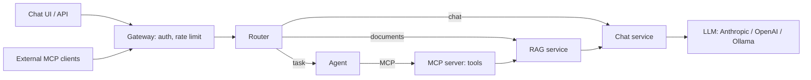

# Assistant Platform

[](LICENSE)


A personal AI assistant that answers from your own PDFs and can run a few safe tools. It merges four
projects behind one chat interface:

- **Chatbot**: the front door. Streaming replies and conversation history.
- **RAG**: answers grounded in your documents, with citations.
- **Agent**: plans multi-step tasks and calls tools. Anything that changes data asks you first.
- **MCP server**: the single source of truth for tools. The agent uses it, and so can Claude Desktop,
  Cursor or any other MCP client.

A small router decides, per message, which path to take. The full explanation (architecture,
design decisions, request flows, security model, deployment) is in the separate
`Assistant_Platform_Guide.pdf` that was delivered alongside this project.



## Quick start (local)

Requires Python 3.11+.

```bash
python -m venv .venv && source .venv/bin/activate
pip install -e ".[dev]"
cp .env.example .env
python -c "import secrets; print(secrets.token_urlsafe(32))"   # put the output in .env as API_KEYS=
# also set ANTHROPIC_API_KEY (or LLM_PROVIDER=openai|ollama and the matching settings)
python -m assistant.api
```

Open http://127.0.0.1:8000, paste your API key, upload a PDF and ask about it.

## Quick start (Docker)

```bash
cp .env.example .env                   # set API_KEYS and your LLM key (CHROMA_VERSION is pre-set to the tested version)
docker compose up -d --build
docker compose ps                      # wait until both services are healthy
```

Optional HTTPS: set `DOMAIN` in `.env`, then `docker compose --profile tls up -d`.
Back up the `app_data` and `chroma_data` volumes. `docker compose down -v` deletes them.

## Configuration

Everything is configured through `.env` (see `.env.example` for every setting and its default). Key ones:

| Setting | Meaning |
|---|---|
| `API_KEYS` | Comma-separated access keys, 16 characters or more. The API won't start without one. |
| `LLM_PROVIDER`, `LLM_MODEL` | `anthropic` (default), `openai` or `ollama`, plus an optional model name |
| `EMBEDDING_PROVIDER` | `local` (default, no key needed) or `openai` |
| `RAG_MIN_SCORE` | Passages scoring below this are ignored. Tune it with the eval script. |
| `ROUTER_MIN_CONFIDENCE` | Below this, document and agent routes fall back to plain chat |
| `RATE_LIMIT_PER_MINUTE` | Per API key. 0 turns it off. |

In Docker, secrets can also be mounted as files in `/run/secrets` (named `anthropic_api_key`,
`openai_api_key`, `api_keys`, `agent_mcp_api_key`).

## HTTP API

Every endpoint except `/health`, `/` and `/app.js` needs `Authorization: Bearer <key>` or `X-API-Key: <key>`.

| Endpoint | Purpose |
|---|---|
| `POST /chat` | `{"conversation_id", "message"}`. Streams server-sent events: `route`, `sources`, `text`, `confirm`, `done`, `error` |
| `POST /chat/confirm` | `{"conversation_id", "run_id", "approved"}`. Answers an agent approval request |
| `POST /documents` | Upload a PDF as multipart field `file` |
| `GET /documents` | List indexed documents |
| `/mcp` | MCP server over streamable HTTP (same keys) |
| `GET /health` | Liveness probe |

## Using the MCP server from other tools

Standalone, over stdio (for example Claude Desktop). Use absolute paths and check your client's docs for the exact config format:

```json
{
  "mcpServers": {
    "assistant-platform": {
      "command": "/absolute/path/to/.venv/bin/python",
      "args": ["-m", "assistant.mcp_server"],
      "env": { "DB_PATH": "/absolute/path/data/app.db", "SANDBOX_DIR": "/absolute/path/data/sandbox" }
    }
  }
}
```

Over HTTP, point a client at `http://127.0.0.1:8000/mcp` with an `Authorization: Bearer <key>` header.

Each capability also runs on its own: `python scripts/chat_cli.py`, `python scripts/rag_cli.py`,
`python -m assistant.mcp_server`, `python scripts/agent_cli.py "task"`.
The whole product in a terminal: `python scripts/assistant_cli.py`.

## Development

```bash
pip install -c constraints.txt -e ".[dev]"   # reproducible, known-good dependency versions
ruff check src tests scripts evals           # lint
pytest -q                                    # tests
```

`constraints.txt` holds the exact versions this project was tested with. CI runs lint and tests on
Python 3.11 and 3.12 and builds the Docker image.

## Tests and evaluation

```bash
pytest -v                                   # unit tests plus one end-to-end test (offline, no API keys)
python evals/run_rag_eval.py                # retrieval quality (free). Suggests a RAG_MIN_SCORE
python evals/run_rag_eval.py --answers      # also checks generated answers (uses your LLM)
```

To evaluate on your own documents, add `.txt` files to `evals/corpus/` (separate pages with a line
containing `=== PAGE ===`) and questions to `evals/questions.jsonl`.

## Security model

- API keys on every route, including MCP. Conversations and approvals are isolated per key.
- Tools that change data always ask for approval. Search tools ask once a run has read untrusted content.
- Documents, files and web results are labeled as untrusted data for the model. `read_file` is confined to one folder.
- The agent's MCP subprocess gets an allowlisted environment, not your API keys.
- Uploads are size-limited, type-checked and parsed before they are kept. The chat page renders text only and ships a strict CSP.
- The container runs as a non-root user with no extra capabilities. Chroma is never published to the host.

## Troubleshooting

| Symptom | Check |
|---|---|
| `Configuration error: No API keys configured` | Set `API_KEYS` in `.env` |
| `agent_unavailable` in the logs | The MCP subprocess failed to start. The app still works, with chat only |
| Document answers say "couldn't find it" | Lower `RAG_MIN_SCORE` (use the eval script's suggestion) and check `GET /documents` |
| Scanned PDF is rejected | It has no text layer. OCR is not supported |
| `chroma` never becomes healthy | `docker compose logs chroma`, and compare `CHROMA_VERSION` with the image's docs |
| Tokens arrive in one block behind a proxy | Disable response buffering for `/chat` |

## Known limits

Single host and single worker. Rate limits, pending approvals and agent checkpoints live in memory
and reset on restart. Documents are shared across API keys. Tool calling uses JSON in the prompt rather
than native tool-use APIs.

## License

[MIT](LICENSE)
